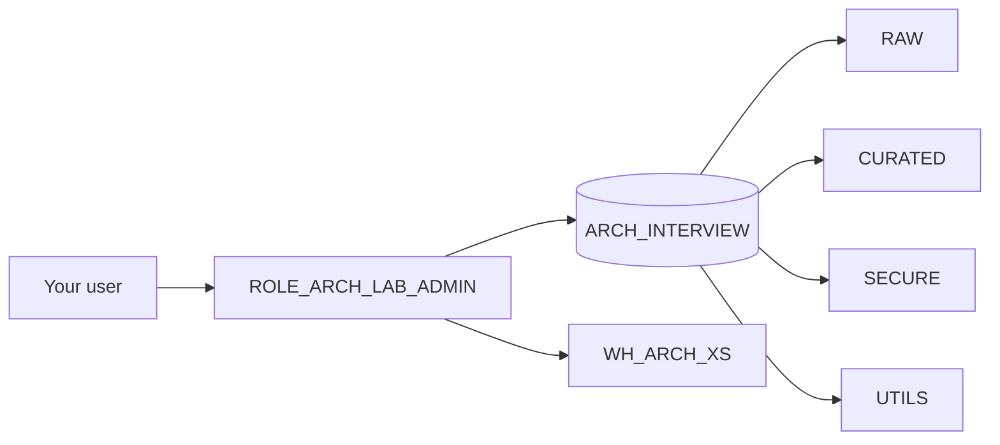
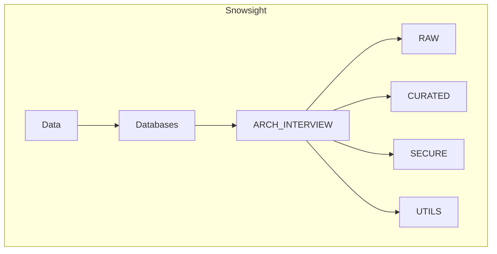

# Lab 00 — Course setup (do this once)

**Time:** ~15 minutes  
**Goal:** Create a clean playground so Labs 01–02 work without guessing object names.

## What you will create

| Object | Name |
|--------|------|
| Database | `ARCH_INTERVIEW` |
| Schemas | `RAW`, `CURATED`, `SECURE`, `UTILS` |
| Warehouse | `WH_ARCH_XS` (X-Small) |
| Admin role for labs | `ROLE_ARCH_LAB_ADMIN` |



## Step 1 — Open Snowsight

1. Log into Snowflake (app.snowflake.com or your account URL).
2. Open **Projects → Worksheets** (or **Worksheets**).
3. Create a new SQL worksheet named `lab_00_setup`.
4. In the worksheet context picker (top), choose a role that can create databases — usually `ACCOUNTADMIN` or `SYSADMIN` for a trial.

> **Interview tip:** In production you almost never day-to-day as `ACCOUNTADMIN`. For labs, using it once to bootstrap is fine. Say that out loud in interviews.

## Step 2 — Run the bootstrap SQL

Open [`sql/00_bootstrap.sql`](../../sql/00_bootstrap.sql) and run the **entire** script in the worksheet (Run All).

Or paste:

```sql
-- Lab 00 bootstrap (safe to re-run)
USE ROLE ACCOUNTADMIN;

CREATE WAREHOUSE IF NOT EXISTS WH_ARCH_XS
  WAREHOUSE_SIZE = 'XSMALL'
  AUTO_SUSPEND = 60
  AUTO_RESUME = TRUE
  INITIALLY_SUSPENDED = TRUE
  COMMENT = 'Interview prep lab warehouse';

CREATE ROLE IF NOT EXISTS ROLE_ARCH_LAB_ADMIN
  COMMENT = 'Owns interview prep lab objects';

GRANT USAGE ON WAREHOUSE WH_ARCH_XS TO ROLE ROLE_ARCH_LAB_ADMIN;
GRANT OPERATE ON WAREHOUSE WH_ARCH_XS TO ROLE ROLE_ARCH_LAB_ADMIN;

CREATE DATABASE IF NOT EXISTS ARCH_INTERVIEW
  COMMENT = 'Snowflake Architect interview prep';

GRANT OWNERSHIP ON DATABASE ARCH_INTERVIEW TO ROLE ROLE_ARCH_LAB_ADMIN COPY CURRENT GRANTS;

GRANT ROLE ROLE_ARCH_LAB_ADMIN TO USER IDENTIFIER($CURRENT_USER);
-- If the line above fails on your account, run manually:
-- GRANT ROLE ROLE_ARCH_LAB_ADMIN TO USER "<YOUR_USERNAME>";

USE ROLE ROLE_ARCH_LAB_ADMIN;
USE WAREHOUSE WH_ARCH_XS;
USE DATABASE ARCH_INTERVIEW;

CREATE SCHEMA IF NOT EXISTS RAW;
CREATE SCHEMA IF NOT EXISTS CURATED;
CREATE SCHEMA IF NOT EXISTS SECURE;
CREATE SCHEMA IF NOT EXISTS UTILS;
```

**If `IDENTIFIER($CURRENT_USER)` fails:**  
Run `SELECT CURRENT_USER();`, then:

```sql
USE ROLE ACCOUNTADMIN;
GRANT ROLE ROLE_ARCH_LAB_ADMIN TO USER "YOUR_USERNAME_HERE";
```

## Step 3 — Prove it worked (checklist)

Switch role to `ROLE_ARCH_LAB_ADMIN` and warehouse to `WH_ARCH_XS`, then run:

```sql
SELECT CURRENT_ROLE(), CURRENT_WAREHOUSE(), CURRENT_DATABASE();

SHOW SCHEMAS IN DATABASE ARCH_INTERVIEW;
```

**Pass criteria**

- Role = `ROLE_ARCH_LAB_ADMIN`
- Warehouse = `WH_ARCH_XS`
- Database = `ARCH_INTERVIEW`
- Schemas include `RAW`, `CURATED`, `SECURE`, `UTILS`

### What you should see in Snowsight

```text
Data → Databases → ARCH_INTERVIEW
  ├── RAW
  ├── CURATED
  ├── SECURE
  └── UTILS
```



## Step 4 — Optional: load tiny sample rows

Run [`sql/00_sample_data.sql`](../../sql/00_sample_data.sql) so Lab 01 has customers to protect.

## Done when

- [ ] You can switch to `ROLE_ARCH_LAB_ADMIN` without errors  
- [ ] `ARCH_INTERVIEW` has four schemas  
- [ ] Warehouse auto-suspends (cost stays near zero)

## Interview soundbite (say this)

> “I bootstrap a dedicated lab/role/warehouse so demos never pollute prod. Least privilege starts with isolation of the playground itself.”

---

**Next:** [Lab 01 — RBAC like an architect](../01_rbac_architect/README.md)
