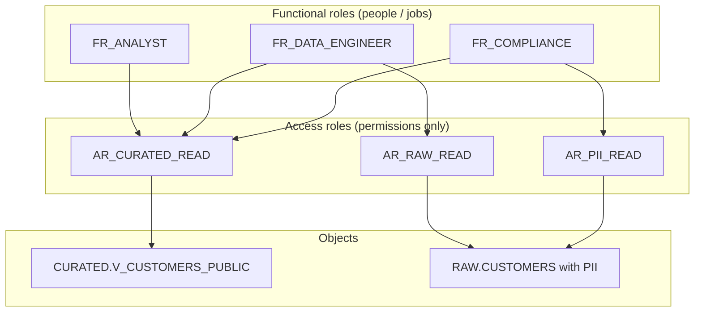
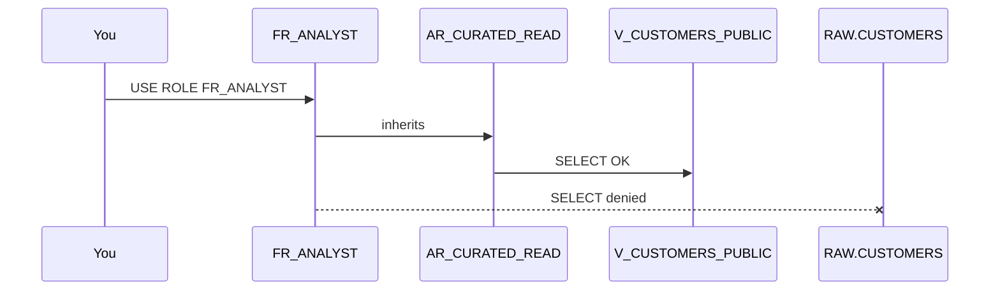

# Lab 01 — RBAC like an architect

**Time:** ~35–45 minutes  
**Interview weight:** Extremely high for Snowflake Architect  
**Prereq:** [Lab 00](../00_setup/README.md) + sample data  
**Study guide:** Domain **1.2** — functional vs access roles, secure views, privilege inheritance ([map](../../docs/study_guide_map.md))

## Interview question this lab answers

> “How do you design RBAC in Snowflake for analysts, engineers, and compliance without giving everyone `SELECT` on raw PII?”

**Bad answer:** “We create roles and grant tables.”  
**Architect answer:** “We separate **functional roles** (who you are) from **access roles** (what you can touch), grant only access roles the privileges, and grant access roles to functional roles. Analysts never get raw PII tables — they get curated secure views.”



## Step 1 — Confirm sample data exists

```sql
USE ROLE ROLE_ARCH_LAB_ADMIN;
USE WAREHOUSE WH_ARCH_XS;
USE DATABASE ARCH_INTERVIEW;
SELECT COUNT(*) AS n, COUNT(SSN_LAST4) AS pii_rows FROM RAW.CUSTOMERS;
```

Expect `n = 5`. If zero, run [`sql/00_sample_data.sql`](../../sql/00_sample_data.sql).

## Step 2 — Build the role graph

Run the full script: [`sql/01_rbac.sql`](../../sql/01_rbac.sql)

That creates:

| Type | Roles |
|------|--------|
| Access | `AR_RAW_READ`, `AR_CURATED_READ`, `AR_PII_READ` |
| Functional | `FR_ANALYST`, `FR_DATA_ENGINEER`, `FR_COMPLIANCE` |
| Object | `CURATED.V_CUSTOMERS_PUBLIC` (no email/phone/ssn) |

## Step 3 — Prove analyst cannot see PII

In the worksheet **context picker**, switch role to `FR_ANALYST` (keep warehouse `WH_ARCH_XS`).

```sql
USE ROLE FR_ANALYST;
USE WAREHOUSE WH_ARCH_XS;
USE DATABASE ARCH_INTERVIEW;

-- SHOULD WORK
SELECT * FROM CURATED.V_CUSTOMERS_PUBLIC;

-- SHOULD FAIL (insufficient privileges)
SELECT * FROM RAW.CUSTOMERS;
```

**Pass criteria**

- View returns 5 rows **without** email / phone / SSN  
- Raw table query errors with privilege denial  

### Mental screenshot — worksheet role switch

```text
[ Role: FR_ANALYST ▼ ]  [ WH: WH_ARCH_XS ▼ ]  [ DB: ARCH_INTERVIEW ▼ ]
```

If you still see `ROLE_ARCH_LAB_ADMIN`, you did not switch — the failure demo will not teach anything.

## Step 4 — Prove engineer can read RAW (still careful)

```sql
USE ROLE FR_DATA_ENGINEER;
SELECT CUSTOMER_ID, EMAIL FROM RAW.CUSTOMERS LIMIT 5;
SELECT * FROM CURATED.V_CUSTOMERS_PUBLIC LIMIT 5;
```

Both should succeed. In interviews, mention: “Engineers get raw for pipeline work; we still add masking policies in production so even engineers don’t casually browse SSN.”

## Step 5 — Compliance path

```sql
USE ROLE FR_COMPLIANCE;
SELECT CUSTOMER_ID, SSN_LAST4 FROM RAW.CUSTOMERS;
```

Should succeed. Compliance has `AR_PII_READ`.

## Step 6 — Inspect the grant graph (architect habit)

```sql
USE ROLE ROLE_ARCH_LAB_ADMIN;

SHOW GRANTS TO ROLE FR_ANALYST;
SHOW GRANTS TO ROLE AR_CURATED_READ;
SHOW GRANTS OF ROLE AR_CURATED_READ;
```

You should see:

- `FR_ANALYST` has role `AR_CURATED_READ`
- `AR_CURATED_READ` has `SELECT` on the view
- Users who have `FR_ANALYST`



## Step 7 — Practice the interview answer (out loud, 60–90 sec)

Use this script; customize with what you just proved:

1. **Principle:** functional vs access roles; never grant table privileges directly to human functional roles in mature designs.  
2. **Layers:** RAW (restricted) → CURATED (broad read) → SECURE (controlled PII).  
3. **Proof:** “Analyst role can query the curated view; raw PII select fails — I just demonstrated it.”  
4. **Next controls:** masking policies, row access policies, secondary roles, ownership discipline.  
5. **Ops:** future grants so new tables don’t silently become world-readable.

## Common follow-ups (short answers)

| They ask | You say |
|----------|---------|
| Why not one role per person? | Explodes grants; use functional roles + IdP group mapping. |
| What about `ACCOUNTADMIN`? | Break-glass only; not daily driver. |
| Secondary roles? | Useful for “activate extra access” without role switching; design carefully. |
| How do you manage this in dbt? | dbt owns transforms; Snowflake RBAC owns who can read results — don’t mix responsibilities. |

## Done when

- [ ] Analyst: view OK, raw FAIL  
- [ ] Engineer: raw OK  
- [ ] Compliance: PII OK  
- [ ] You can explain the diagram without looking  

## Optional official Snowflake lab (after this one)

Only if you want deeper exam-aligned practice — **not required** before Lab 02:

- [Process PII with RBAC, masking, row access](https://www.snowflake.com/en/developers/guides/getting-started-with-pii/) (Quickstart named under Domain 1 study resources theme)

## Cleanup (optional — keep for Lab 02)

Do **not** drop `ARCH_INTERVIEW` yet. Lab 02 reuses it.

---

**Next:** [Lab 02 — dbt incremental on Snowflake](../02_dbt_incremental/README.md)  
**Hub:** [docs/index.html](../../docs/index.html)
