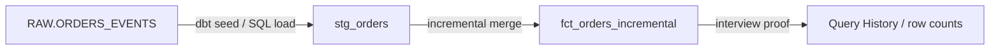
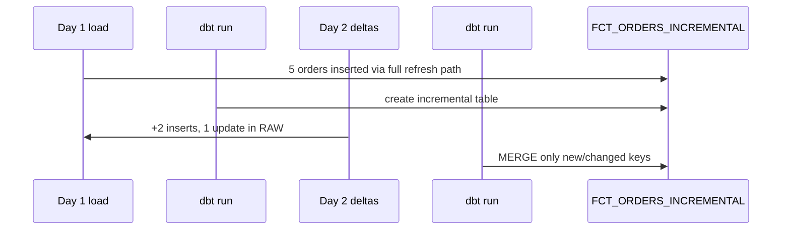

# Lab 02 — dbt incremental models on Snowflake

**Time:** ~40 minutes  
**Interview weight:** Extremely high for Snowflake + dbt Architect roles  
**Prereq:** Lab 00; dbt installed (you said VS Code + dbt is ready)

## Interview question this lab answers

> “When do you use dbt incremental `merge` on Snowflake, and how do you avoid full-table rebuild costs?”

**Architect answer:**  
“For append-heavy or slowly changing fact/event tables, I use incremental with a reliable watermark (`updated_at` / `event_ts`) and a unique key. On Snowflake I prefer `merge` strategy when I need upserts; I prove with `dbt run` then show row counts and Query History that the second run scanned only new partitions of work — not a full rebuild. I don’t incremental everything: small dims can stay table/view.”



## Step 1 — Open the sample dbt project

Project path in this repo:

```text
dbt_project/
```

Files you care about:

| File | Purpose |
|------|---------|
| `dbt_project.yml` | Project name + model paths |
| `profiles.yml.example` | Copy to your dbt profiles |
| `models/staging/stg_orders.sql` | Staging view |
| `models/marts/fct_orders_incremental.sql` | Incremental merge model |
| `models/marts/schema.yml` | Tests / contract-ish docs |

## Step 2 — Configure dbt profile (once)

1. Find your profiles file (usually `~/.dbt/profiles.yml` on Windows: `C:\Users\<you>\.dbt\profiles.yml`).
2. Copy settings from [`dbt_project/profiles.yml.example`](../../dbt_project/profiles.yml.example).
3. Fill account, user, role `ROLE_ARCH_LAB_ADMIN`, warehouse `WH_ARCH_XS`, database `ARCH_INTERVIEW`, schema `CURATED`.

Test:

```bash
cd dbt_project
dbt debug
```

**Pass:** all checks green / connection OK.

## Step 3 — Load source events into Snowflake

In Snowsight (role `ROLE_ARCH_LAB_ADMIN`), run [`sql/02_orders_source.sql`](../../sql/02_orders_source.sql).

This creates `RAW.ORDERS_EVENTS` with day-1 rows.

## Step 4 — First dbt run (builds incremental table)

```bash
cd dbt_project
dbt run --select stg_orders fct_orders_incremental
dbt test --select fct_orders_incremental
```

Verify in Snowflake:

```sql
USE ROLE ROLE_ARCH_LAB_ADMIN;
USE DATABASE ARCH_INTERVIEW;
SELECT COUNT(*) AS rows_after_first_run FROM CURATED.FCT_ORDERS_INCREMENTAL;
SELECT * FROM CURATED.FCT_ORDERS_INCREMENTAL ORDER BY ORDER_ID;
```

## Step 5 — Simulate new + changed rows (the interview moment)

Run [`sql/02_orders_day2.sql`](../../sql/02_orders_day2.sql) (new orders + one status update).

Then:

```bash
dbt run --select fct_orders_incremental
```

Verify:

```sql
-- New orders appear; updated order shows new STATUS / UPDATED_AT
SELECT ORDER_ID, STATUS, UPDATED_AT
FROM CURATED.FCT_ORDERS_INCREMENTAL
ORDER BY ORDER_ID;
```

**Pass criteria**

- Row count increased by new orders only (not doubled blindly)  
- Changed order shows updated status (merge worked)  



## Step 6 — What to say about cost & Snowflake specifics

Open **Admin → Query History** (or **Activity → Query History**) and find the second `MERGE` statement dbt issued.

Talking points:

1. **Why merge:** need upserts when source sends late-arriving updates.  
2. **Watermark:** `updated_at > max(updated_at)` from target — must be trustworthy.  
3. **Unique key:** without it, merge is wrong and interviews will catch you.  
4. **When NOT incremental:** tiny dims; when logic changes often and full refresh is safer.  
5. **vs Dynamic Tables / Streams+Tasks:** dbt shines for governed SQL transforms + CI; dynamic tables shine for declarative lag inside Snowflake; streams+tasks for CDC-style pipelines. Architects choose per SLA/ownership — not fanboy one tool.

## Step 7 — 60-second interview script

> “For facts with daily deltas I use dbt incremental merge on Snowflake with a unique order_id and updated_at watermark. First run builds the table; subsequent runs merge only changes. I validate with tests on uniqueness and not_null, and I check Query History to confirm we’re not full-scanning rebuilds. Raw stays in RAW; curated marts are what analysts get — tied back to the RBAC model from Lab 01.”

## Troubleshooting

| Problem | Fix |
|---------|-----|
| `dbt debug` auth fails | Check account locator, user, MFA/keypair, role name |
| Model builds in wrong DB | profiles `database:` / `schema:` |
| Merge doesn’t update | Source `UPDATED_AT` not bumped on change |
| Permission error | Use `ROLE_ARCH_LAB_ADMIN`; grant if objects owned elsewhere |

## Done when

- [ ] `dbt debug` works  
- [ ] First run + second run both succeed  
- [ ] You can explain merge vs full-refresh without notes  

## Feedback I need from you after this lab

Reply with:

1. Did steps feel too slow / too fast / too wordy?  
2. Was the Snowsight role-switching clear?  
3. Prefer more screenshots (annotated UI) or more diagrams?  
4. Any topic you know your interview will hit next?

---

**Hub:** [docs/index.html](../../docs/index.html)
